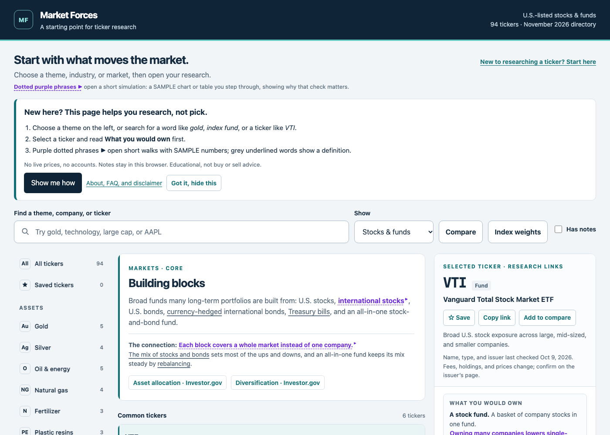
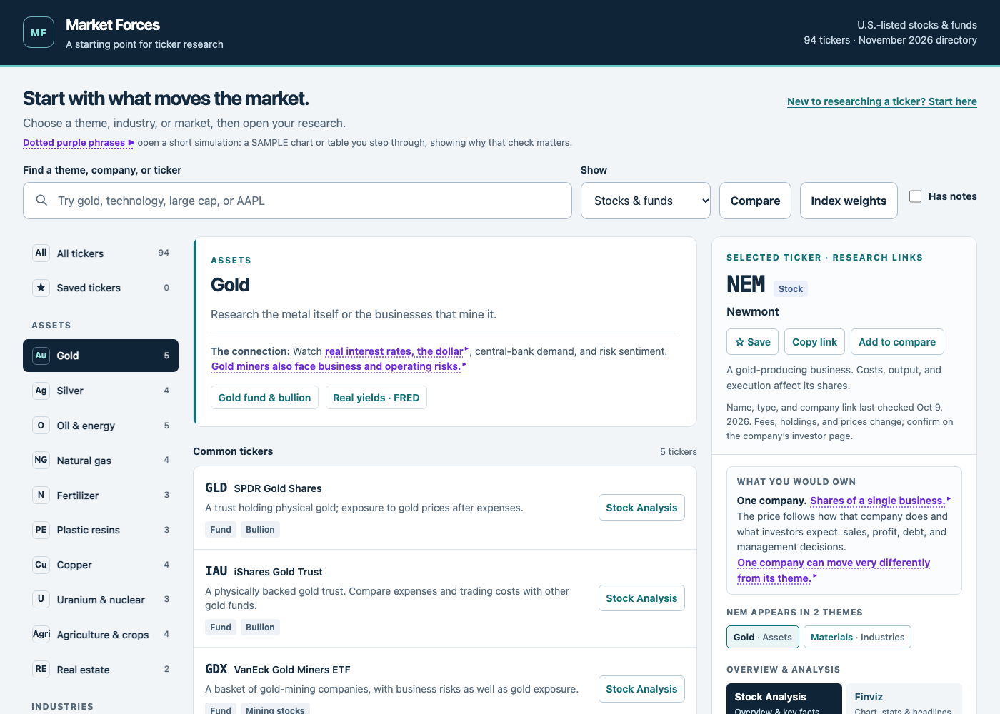
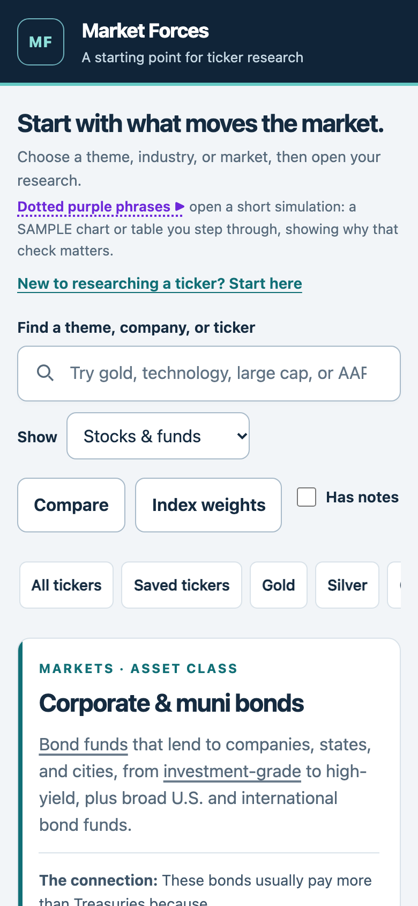

# Market Forces

By Weng (Weng Fei Fung)

Beginner’s directory of common stocks and funds, grouped by economic theme, with research links for each ticker.

## What you can do

- **Browse by theme.** Assets, industries, markets, and economic forces, each with the economic connection and one or two primary sources.
- **Open a ticker's research.** Overview, financials or fund documents, news, and discussion links, plus a plain note on what you would own (one company, a stock fund, a bond fund, Treasury bills, a bullion trust, a futures fund, or a currency trust) and every theme the ticker appears in.
- **Compare up to 3 tickers.** Turn on Compare and check tickers to see type, exposure, issuer, themes, and main links side by side. It compares structure, not performance.
- **See index weights.** Index weights shows where a ticker sits in dated index snapshots.
- **Save tickers and keep notes.** Both stay in this browser. Search also finds words in your notes. Back up and restore them from the research guide.
- **Share or bookmark a view.** The address keeps the theme, ticker, search, filter, and Compare or Index weights picks, for example `#theme=gold&ticker=GLD` or `#theme=gold&compare=GLD,IAU,NEM`. Copy link on the research panel copies it.
- **Keyboard.** Press `/` to search and `Esc` to clear it.

No live prices. These are research starting points, not buy or sell recommendations.

## Check the catalog

After editing `data/catalog.json` or `data/index-weights.json`, run `node tools/check-catalog.mjs`. It needs no packages. It fails on a theme symbol missing from `instruments`, a duplicate symbol or theme id, a missing field, an unknown group or category, or a link that is not `https://`, and warns about tickers no theme lists.
